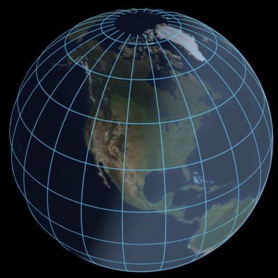

# eutopia.ts

A TypeScript WebGPU library for rendering interactive worlds.

Compose a world from reactive layers for terrain, lines, fills, polygons, text, billboards, and instanced objects. The library includes view controls, picking, and transitions.

Designed for performance, terrain level-of-detail calculations and elevation sampling run on the GPU.

Fixed-point horizontal coordinates provide less than 2 cm resolution at the equator, avoiding global-scale `f32` precision loss.

## Installation

```sh
npm install eutopia.ts
```

## Example



```ts
import { $, atmosphere, createDevice, createWorld, line, now, terrain } from "eutopia.ts";
import type { Vec3, Vec4, View } from "eutopia.ts";

const element = document.createElement("canvas");
document.body.appendChild(element);

const device = await createDevice();

const view: View = {
  center: [-98.5795, 39.8283, 0],
  distance: 15_000_000,
  orientation: [0, 0, 0],
  fieldOfView: 45,
};

const color: Vec4 = [0.2, 0.8, 1, 0.65];
const grid = (position: (t: number) => Vec3) =>
  Array.from({ length: 100 }, (_, i) => ({
    position: position(i / 99),
    color,
    width: 40_000,
    minWidthPixels: 1,
    maxWidthPixels: 5,
  }));
const vertices = [
  ...Array.from({ length: 11 }, (_, i) =>
    grid(t => [-180 + 360 * t, -75 + i * 15, 10_000]),
  ),
  ...Array.from({ length: 24 }, (_, i) =>
    grid(t => [-180 + i * 15, -80 + 160 * t, 10_000]),
  ),
];

const time = $(() => new Date(performance.timeOrigin + now() * 10000));

createWorld({
  element,
  device,
  view,
  layers: [atmosphere({ time }), line({ vertices })],
});
```
